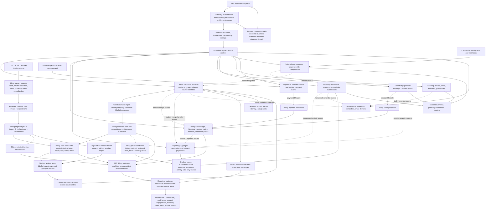

# Business data feeds and imported student identities

Reviewed against implemented source on 2026-10-11. The initial implementation plan was recorded before changing the services; this document now describes the implemented contracts. The [repair review](../reviews/2026-10-11-import-data-feeds.md) records verified causes, local browser evidence, hosted repair and publication checks. Deployment remains Cloudflare Pages, private Workers, service bindings and separate Neon PostgreSQL databases through Hyperdrive. These changes were published on 11 October 2026; six private-binding hosted read probes returned HTTP 200 after repairing the existing source.

## Faults found

1. The previous work import persisted source files and work rows in Billing without creating Clients records or student associations. A source label is not a CRM student ID. Missing email was not the blocker: Clients already supported name-only student profiles. The implemented student review now explicitly creates or selects Clients students and repairs existing sources without reimporting work.
2. The previous `HistoryAnalyticsService` set repeatable-read isolation inside `withTenant`, after the tenant-setting SELECT. PostgreSQL rejected that sequence with SQLSTATE `25001`. Reporting then marked the entire Billing aggregate unavailable, so hours, money, trends and Billing timezone disappeared together while CRM counts survived. Several database tests suppressed that statement and missed the failure. Isolation is now selected in `BEGIN`, and actual tenant-helper tests execute it without suppression.
3. Student metrics require reviewed canonical associations. Logged hours and monetary declarations are valid even without those associations. Imported rows are not automatically treated as classes. Work status `paid` is an assertion in the source, not evidence of a payment provider transaction.
4. The Dashboard performs two concurrent aggregate reads; it does not fetch once per student. Work history and Dashboard use different Billing endpoints, explaining why one can work while the other fails. Reporting reads business aggregates live; this screen is not waiting for an event projection.

## Complete feed map

Solid arrows are request/response or owned data reads. Dashed arrows are transactional-outbox events. Each service owns its database. A drawn connection is a contract or service binding, never a cross-service database join.

## Ownership and consistency

| Domain | Owns | Primary feeds | Readers |
| --- | --- | --- | --- |
| Platform | Identity, memberships, settings, capabilities | Registration and business configuration | Gateway, feature gates |
| Clients | Canonical student IDs, contact details, groups, merges, reviewed source mappings | CRM entry/import, integration contacts, reviewed work-import students | CRM, tracker, Billing association verification, Planning profile resolution |
| Billing | Source bytes, work rows, associations, historical invoice declarations, invoices, allocations and rates | Workbook commit, explicit identity review, Scheduling and Payments events | Work tracker, invoice views, business analytics, tutor finance |
| Reporting | Business aggregate composition and student summary projections | Live Clients/Billing aggregate contracts; domain events for student summaries | Business Dashboard and tracker |
| Scheduling | Sessions and provider booking state | Integrations connector events | Session calendar, Billing, Reporting, student booking |
| Learning | Assignments, attachments, essay links, submissions and learning activity | Tutor/student actions | Learning screens, portal, Reporting, Notifications |
| Planning | Boards, tasks, template rules and deadlines | Student profiles plus reviewed template selections | Portal, tutor tracker, Notifications |
| Payments | Provider requests and authenticated lifecycle records | Tenant connector configuration and provider webhooks | Billing allocation events and payment screens |
| Integrations | Tenant credentials and provider ingestion | Connector setup, signed provider webhooks and sync | Scheduling, Clients, attribution, booking configuration |
| Notifications | Delivery preferences, queued email and reminder state | Explicit invitation/reminder events | Delivery status and activity |

Business Dashboard is a live composition. Student tracker summary history is a separate event projection; the two must not be mistaken for the same feed. The tracker now has a separate staff Work view backed by Billing's reviewed work-history contract. Imported work does not fabricate native bookings or payment events.

## Repair and new import workflow

1. Keep the original source bytes and original labels. Commit work rows once using the existing checksum and idempotency rules.
2. After committing a work source, the Web import flow opens student review when the caller can manage Clients. The same review is available through Original files → Match students on previously committed work sources. The Web reads 500 rows per page, batches candidate and save requests in groups of at most 100, and lets staff select row subsets or leave names for later.
3. Billing supplies source-bound work IDs, revisions, dates and labels. A group key is lowercase hexadecimal SHA-256 over sorted lowercase work UUIDs joined by a newline, without a trailing newline; it identifies a reviewed row set, not a person. Billing and Clients normalize names using NFKC, collapsed whitespace and lowercase. No fuzzy name merge, invented contact details or automated invitation.
4. Clients returns batched exact-name candidates. A unique candidate is suggested and requires acceptance; ambiguous candidates require a deliberate selection. Unmatched names can create name-only profiles as an explicit batch choice. A name-only student can be enriched later.
5. Clients persists `(business, importId, groupKey)` decisions, the normalized input digest and selected canonical student ID in `client_work_import_identities`. Retrying a creation returns the same identity. Preview returns both `resolvedStudentId` and `resolvedAction`, so reopening preserves the saved create/link choice. A changed decision for an already resolved key conflicts; staff can revise row associations through the existing manual identity review.
6. Billing verifies row ownership/revisions, requests Clients resolutions via a signed service binding, then atomically links reviewed work rows and stores receipts in `billing_work_import_student_reviews`. It preserves dates, quantities, amounts, statuses and original bytes. An identical completed decision replays without revision increments or additional events only while its resulting rows/revisions are current. If Clients commits but Billing fails, retry recovers the saved mapping. A changed work or identity revision returns a conflict; a concurrent correction rejects the entire Billing batch.
7. Do not hold a database transaction open while waiting on another service. Validate before the request, then lock and revalidate before applying Billing associations. Cross-service operations are recoverable steps, not a distributed database transaction.
8. Skip and ambiguous groups remain visible for later review. New name-only profiles use Clients' default `lead` stage, with communication opt-ins disabled. Creation does not grant portal access or classify work as classes. The Web requires confirmation of the reviewed names and selected rows before saving.

### Implemented bounded HTTP contracts

- `GET billing/v1/history-imports/:id/students?limit=1000&offset=0`: `{ item: { source, groups: [{ key, name, normalizedName, rows: [{ id, revision, identityRevision, date, studentName, serviceType, hours, identity }] }], total, limit, offset } }`. Only committed work sources; limit 1–1000, offset 0–1,000,000. `source` uses the existing source summary; `identity` uses the reviewed identity view. Groups contain the current page's rows, ordered by source row then ID. Group keys can differ between pages or selected row subsets.
- `POST clients/v1/clients/work-import/preview`: `{ importId, groups: [{ key, name }] }` → `{ item: { groups: [{ key, name, candidates: [{ id, displayName, email }], resolvedStudentId, resolvedAction, ambiguous }] } }`; at most 100 unique groups per request, at most 20 displayed exact-name candidates per group. `resolvedAction` is `create`, `link` or null. Ambiguity considers the complete candidate count, including matches beyond the display limit.
- `POST clients/v1/clients/work-import/resolve`: `{ importId, decisions: [{ key, name, action: 'create' | 'link', studentId? }] }` → `{ item: { groups: [{ key, studentId, created }] } }`; durable mapping, input digest, tenant lock, no opt-ins. Maximum 100 decisions.
- `POST billing/v1/history-imports/:id/students`: `{ groups: [{ key, name, action: 'create' | 'link', studentId?, rows: [{ id, revision, identityRevision }] }] }` → `{ item: { importId, linked, created, replayed, groups: [{ key, studentId, created, rows: [{ id, revision, identityRevision }] }] } }`. Validate keys against sorted owned work IDs and normalized source names; maximum 100 unique groups / 1000 unique rows per request. Clients resolves pending groups in one bounded request; Billing applies in one tenant transaction. Partial requests can be retried or continued without reimporting history. Work and identity revisions replace an `Idempotency-Key` header for this route.
- `GET clients/v1/clients/:id/identity`: `{ item: { id, kind } }`. Compact canonical identity verification without contact details, related-contact lists or workbook data. Staff only, Clients entitlement and `clients.read`; student-scoped tutors must hold grants for both requested and canonical IDs. Billing requires `kind: 'student'`. Both manual identity review and per-student work history use this route with signed authorization, a five-second full-response deadline and a 64 KiB response bound.
- `GET billing/v1/students/:id/work-history?month=YYYY-MM&limit=50&offset=0`: `{ item: { studentId, month, currencies, rows, total, limit, offset, provenance: 'historical_work_declarations' } }`. Limit 1–100 and offset 0–1,000,000. Omit month for all rows; a selected month filters rows/counts and adds monthly totals, while all-time currency totals remain available. Rows contain only `{ id, date, serviceType, hours, amountMinor, currency, status, countAsClasses }`; currencies contain `{ currency, totalHours, totalMinor, paidMinor, pendingMinor, unsentMinor, monthHours, monthMinor }`. Only current linked identities count; stale reviews are excluded. Requested, Clients-canonical and Billing-alias IDs all require access. Source bytes, raw columns, original labels and notes are excluded because they can contain other students. Recorded work/status declarations remain separate from native invoices and verified collections.

Billing import-review routes require business staff scope, Billing and Clients entitlements, `billing.read`, `reporting.financial` and `clients.read`; writes additionally require `billing.write` and `clients.write`. Clients' private batch routes require business staff scope, Clients entitlement and `clients.read`, plus `clients.write` for resolution. Per-student Billing history also requires Billing/Clients entitlements and financial/read permissions, but permits a student-scoped tutor with the required student grants. Students and parents cannot use these staff routes. Source labels accept up to 200 characters; new Clients profile names retain the 160-character limit. Financial capabilities remain independent of role labels so future enterprise provisioning can move them up the hierarchy without changing service ownership.

The [Billing README](../../services/billing/README.md#students-from-committed-work-sources) gives counter semantics, source restrictions and response failure behavior. Clients' durable mapping and Billing's completed receipt have distinct purposes: the mapping recovers a contact-side commit, while the receipt proves the exact work-row revisions that Billing completed.

## Metric definitions and dependencies

| Figure | Source and meaning | Missing identity behavior |
| --- | --- | --- |
| CRM students / stages | Canonical Clients student records, all business history | Independent of work linking |
| Recorded hours / monthly work value | Billing work rows selected by their work date | Available before student matching |
| Students with work activity / commitment / inactivity | Fresh, reviewed canonical work identities; uses completed native classes only if no work history exists | Show missing coverage and a review action; never count labels as unique people |
| Class frequency | Explicitly classified imported class rows or completed native classes | Do not infer classes from essay/review work |
| Work unsent / pending / paid | Source work declarations, all history | Separate from invoice balances and verified collections |
| Invoice balances | Native invoice outstanding/draft amounts plus imported invoice declarations | Do not add work statuses again; records can overlap |
| Verified collections | Non-simulated native payment allocations | Workbook `paid` is not provider verification |
| Historical paid invoices | Imported invoice paid declarations | Separate provenance from collections |
| Native class estimate | Rated scheduled/completed classes in selected month | Separate from logged work value because they can overlap |
| Trend | Monthly work hours; most recent 12 months displayed | Hours available; student counts require reviewed coverage |

Keep currencies separate. Use integer minor units and exact safe-range checks. Work dates are calendar dates; native timestamps use Billing timezone for month boundaries. CRM total is all-time; active work and work value use the selected month. Unsent/pending/paid balances are all-time and labeled accordingly. A current month with no rows is a valid zero if the source is available; source failure is unavailable, not zero.

## Performance, security and observability

- Transaction isolation is selected in `BEGIN` before the tenant-setting SELECT. The shared Database helper accepts only an enumerated isolation option, never raw SQL. Tenant context remains transaction-local and all domain tables retain forced RLS. Business analytics executes four domain SQL statements in one repeatable-read snapshot, excluding transaction/tenant setup.
- Source calls run concurrently with a full response deadline and size/schema validation. Database aggregation uses SQL rather than fetching every student. No per-student HTTP loops for Dashboard or import matching.
- Business-scoped browser request snapshots include path/body identity for cached Reporting summaries. Clients/Billing writes invalidate Reporting reads; Billing student resolution additionally invalidates Clients lists. Active list generations and mounted Dashboard subscribers respond to invalidation, with abort/generation checks preventing an old read from repopulating current state. These are browser-local caches, not shared service projections.
- Signed contexts carry permissions, scope and entitlements; do not infer authority from a tenant header or role name. Row revisions, source scope and tenant checks prevent stale associations and cross-business links.
- Log source category, status, duration and correlation reference; omit student names, emails, workbook contents and credentials. Invalid aggregates must leave independent source counts available.
- Tests must exercise the actual tenant transaction helper against PostgreSQL. Do not suppress isolation commands. Cover retry after the Clients step, duplicate commits, ambiguous names, merge aliases, tenant isolation, bounded payloads and mutation refresh.

## Verification state and limits

Service tests exercise the actual tenant helper with ordinary PostgreSQL roles, repeatable-read configuration, permission/source boundaries, name-only creation, ambiguity, aliases, duplicate prevention, partial-commit recovery and concurrent corrections. Web tests cover explicit suggestions, saved create/link action, row-set keys, Reporting read deduplication and mutation invalidation.

The coordinating agent's local browser walkthrough reconciled 84 work rows, 25 newly created profiles plus one existing student, and unchanged 85.5 hours / 647400 integer minor units. Dashboard showed 26 CRM and 26 tracked students. October showed 14.5 work hours, 11 active students and €965 monthly work value; September showed 43 hours, 17 active students and €3824, with 2.53-hour average commitment and 22.22% inactivity. A local Dashboard HTTP 200 response exposed a 42.576 ms timing value in browser Network headers; it is not hosted performance evidence.

The selected existing student's Work tab showed seven September rows and all-history totals of 7 hours / 49000 minor units; October correctly showed zero monthly work and no rows. Reopening Original files → Match students reported all linked, zero new profiles and zero records to link, and finishing added no import/work rows. Compact matching styling was inspected in the local browser.

The existing hosted source was separately repaired: 84 rows / 26 groups, 25 name-only profiles and one reused student, increasing CRM students from 15 to 40. A contact-side partial commit was recovered through durable mappings in four-group batches, with no duplicate profiles and unchanged source/work hashes, 85.5 hours and 647400 EUR minor units. The deadline explanation for the initial interruption remains an inference from retained recovery evidence.

Six hosted probes returned upstream HTTP 200 through Workers/private bindings/Hyperdrive. Clients reported 40 students (2 active, 38 leads); Billing reported 26 tracked, October 14.5 hours / 11 active / 96500 EUR monthly minor units and September 43 hours / 17 active / 382400 EUR monthly minor units. Reporting marked both sources complete in both months. A selected hosted student's Work history returned two October rows (one with limit 1), 10 all-time hours / 70000 minor units and October 3 hours / 21000 minor units. Proxy round trips of 0.992–2.726 seconds came from one bounded batch and are not browser performance measurements.

Both public page endpoints and 19 checked static assets matched the final export; eleven protected route checks returned 401 to anonymous requests. Full deployment and final Web publication commands exited successfully. Final checks passed 251 database-backed tests with zero skips, 87 Web tests, build and typecheck. No private source names, contacts, production IDs or private receipt paths are recorded here. The [review](../reviews/2026-10-11-import-data-feeds.md) separates local browser and hosted API evidence and retains the remaining coverage limits.
