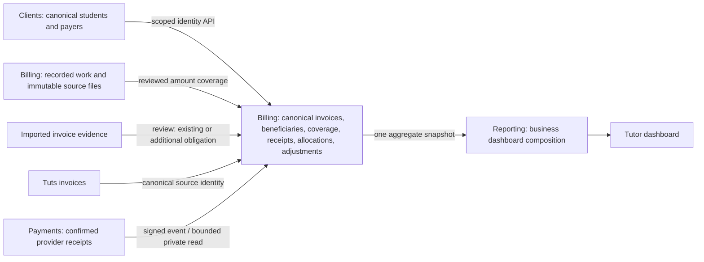

# Financial reconciliation

Implementation contract, 2026-10-11. This adds Billing-owned reconciliation within
the existing ten services and Cloudflare/Neon deployment. It does not move money.

## Ownership and publication

Clients remains the identity authority. Billing verifies student/payer IDs through
private scoped APIs; a name match is a suggestion. Payer identity and student
beneficiaries are separate. Multiple students can share one family invoice.
Payments owns provider authentication and confirmed transactions. Billing owns
the local receipt projection and allocations. Reporting reads aggregate contracts,
never another service's database. Capability checks, rather than a new account
hierarchy, decide financial access. Student access never exposes this interface.

Original uploads, issued invoices, and native allocations are retained. A canonical
invoice references one native or imported source and may acquire more aliases.
New imported documents are staged for review and contribute nothing to published
invoice/settlement totals until accepted. Re-uploading evidence for an existing
invoice creates an alias, not a second obligation. Stable source identities are
unique within a tenant. Names, matching amounts, and dates alone never auto-publish
a duplicate decision.

## Relationships

- Canonical invoice: currency, face amount, payer, invoice date, due date, service
  period, status, revision. These dates have different meanings; October 1 billing
  can cover September work.
- Source alias: imported/native invoice source ID -> canonical invoice ID.
- Beneficiary: invoice -> canonical student; separate from payer.
- Work coverage: many-to-many invoice/work links with an explicit covered amount
  and captured work revision. Coverage cannot exceed the work row or invoice face
  amount. Partial coverage retains the uncovered work contribution.
- Receipt: one tenant/provider/account/transaction identity, currency, amount,
  payment date, evidence category. Provider verified, historical bank evidence,
  and simulated receipts are distinct. A historical paid invoice is a settlement
  declaration, not a fabricated provider receipt.
- Allocation: receipt -> invoice, explicit amount; multiple allocations support
  split payments and partial settlements. Allocations cannot exceed receipt funds
  or an invoice's payable amount. Overlap with a historical declaration confirms
  that covered amount rather than adding another paid contribution.
- Adjustment: explicit credit or refund evidence, reason, date, idempotency key.
  Credits reduce the obligation; refunds reduce net receipts and do not silently
  reopen the original debt. No provider refund is initiated by this ledger.

## Fixed dashboard measures

All values remain separate per currency, in exact integer minor units.

1. Work value: original recorded work value, unaffected by attaching an invoice.
2. Invoiced: distinct accepted issued invoices minus credits.
3. Recorded paid: paid uncovered work plus accepted invoice settlement evidence.
   Each invoice uses the maximum of its historical declaration, paid imported
   aliases, reviewed paid work coverage, and allocated receipts, capped by its
   face amount. Credits reduce the amount owed; a refund separately reduces
   recorded paid. Overlapping evidence is never added together. Attaching paid
   work to an unpaid native invoice preserves that historical paid claim;
   native aliases and simulated transactions never establish verified receipts.
4. Verified received: distinct nonsimulated provider receipts, less recorded
   provider refunds, independent of whether allocated yet.
5. Pending: uncovered pending work plus accepted issued invoice balances.
6. Unsent: uncovered unsent work plus accepted draft invoice balances.
7. Unresolved: staged documents, unallocated receipts and stale coverage are
   shown explicitly; ambiguous evidence is not an additional published contribution.

The first invoice never switches the whole currency to a different source. A
€500 paid work record -> €500 corresponding paid invoice -> €500 receipt keeps
recorded paid at €500. Verified received changes from unknown/zero evidence to
€500. A genuinely additional invoice or new payment changes totals legitimately.
Resolving an old unknown or correcting a source can also change totals; no system
can infer whether two ambiguous €500 documents describe one obligation or two.

## Review workflow and wire contract

Billing endpoints under `/v1/reconciliation` (staff business scope;
`billing.read`, `reporting.financial`; writes also `billing.write`):

- `GET /invoices?state=unresolved|accepted&search=&limit=&offset=` lists evidence
  and published invoices. `GET /invoices/:id` supplies details, source aliases,
  beneficiary/work suggestions, receipts and revision.
- `POST /preview` accepts a reviewed decision and returns before/after currency
  totals, affected invoices and source/invoice/work revision guards; no published
  write. Refreshing revised work updates snapshots for all its invoice links
  atomically, and the preview identifies those other affected invoices.
- `POST /publish` accepts the identical decision with idempotency key, revalidates
  revisions under transaction locks, writes relationships, audit and outbox
  atomically. The UI adds the preview's other-invoice revision guards to its frozen
  publication payload; concurrent changes require another preview.
- `GET /receipts` lists allocatable payment evidence; `POST /receipts/sync` reads
  bounded pages of confirmed Payments transactions outside Billing transactions.
  `POST /receipts` records explicitly historical evidence, never provider verified.
- `POST /allocations` and `POST /adjustments` publish reviewed amount-bearing
  associations/adjustments with idempotency and before/after results.

Decision: source `{kind: imported|native, id, revision}`, choice
`new|existing`, optional existing canonical ID/revision, student IDs, payer ID,
service month, due date, work links `{workId, revision, amountMinor}`, and optional
preview-derived `invoiceGuards` `{invoiceId, revision}` for other affected invoices.
Existing
aliases preserve the obligation's amount/status and issued source snapshot.
Confirmation is explicit. Stable source/receipt IDs plus payload hashes make retries
and independent duplicate deliveries idempotent. Changed decisions fail with 409.

Confirmed receipt read contract lives in shared contracts. Payments returns only
scoped, nonsensitive confirmed transaction fields, not credentials. Billing
consumes confirmation events and can recover pre-deployment receipts through this
read. Financial contexts, producer checks, tenant RLS, caps, advisory/row locks,
numeric overflow validation, and bounded fetch/body deadlines are mandatory.

## Rollout and verification

Additive schema first; native invoices project from their authoritative source,
existing work stays unchanged, imported invoices require review. Keep comparison
totals and provenance available in reconciliation previews. Switch Dashboard last.
Deploy Reporting's backward-compatible reader before Billing's new receipt
coverage label; deploy Payments' recovery endpoint before Billing's binding.
Test same-document aliases, work/invoice/receipt overlap, split/partial settlement,
family beneficiaries, currencies, retry, simultaneous caps, stale revisions,
credits/refunds, tenant isolation and student denial on ordinary PostgreSQL roles.
Never send invoices, create live charges, or email clients during verification.

Performance: set-based projection/backfill and aggregate queries, bounded pages,
indexes on tenant/source/invoice/receipt/work links; no per-student fetch loops in
Dashboard. Dashboard remains two parallel domain reads. Mutations invalidate its
cached snapshot. New fields are additive to existing analytics consumers.

Steady reads perform a single projection freshness check and skip native
projection locks/upserts when no source changed. Legacy initialization uses a
separate ordinary transaction before the consistent analytics snapshot.
`GET /v1/portal/finance` is a tutor-only, beneficiary-scoped canonical ledger;
student/parent contexts are denied. Reviewed family invoices show their full
shared balance on each beneficiary profile, labelled shared; those profile
figures must not be summed to calculate business revenue.

Operational limits: invoice/payment pages have at most 200 records. Invoice
details expose at most 200 same-currency work candidates, source aliases,
beneficiaries and receipts, with at most 200 allocation entries per receipt.
The UI displays the work candidate limit.
Current publication adds beneficiary/work associations; deleting an association
and bank-statement file parsing are not implemented. Accepted invoices can reopen
review to add links or refresh existing work coverage. Known payer, service period
and due date are preserved; conflicting replacements need a separate correction
workflow. Credits cannot reduce an invoice below its allocated gross receipts.
Existing source documents
remain available; PDF uploads without structured fields remain original-file
archives, with manual invoice entry available. No text/OCR inference publishes
financial amounts automatically.

Deployment evidence and remaining limitations belong in the release review; this
document defines required behavior and must not be read as deployment proof.
