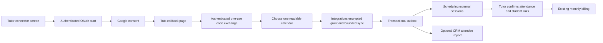

# Google Calendar connector

## Ownership and flow

Google Calendar is an Integrations adapter. Integrations owns the Google OAuth
grant, encrypted tokens, selected calendar and provider snapshots. Scheduling
owns the existing external-session projection and tutor-reviewed attendance.
Clients receives attendee contacts only when the business explicitly enables
that option. Billing continues to use tutor-confirmed class attendance.

## Connection contract

Provider ID: `google_calendar`. The ordinary token-input create route cannot
create Google connections. Google endpoints require current business membership,
the Integrations entitlement and `integrations.manage` for owners/admins.

- `GET /v1/google-calendar/status`: credential-free deployment availability.
- `POST /v1/google-calendar/oauth/start`: returns a Google authorization URL.
- `POST /v1/google-calendar/oauth/complete`: exchanges a one-use state/code for
  an encrypted grant, initially awaiting calendar selection.
- `GET /v1/google-calendar/connections/:id/calendars`: bounded readable calendar
  list without OAuth tokens.
- `POST /v1/google-calendar/connections/:id/select`: selects one calendar and
  attendee import preferences, then schedules synchronization.
- `POST /v1/google-calendar/private-feed`: connects one Google-hosted iCal feed
  with encrypted URL storage. It is available without a platform OAuth client.
- Existing connection list, immediate sync and disconnect routes remain the
  composition API. Selecting a different calendar after activation requires a
  new connection; old projections cannot silently change their identity.

Callback page: `/integrations/google-calendar/callback`. It completes through
the authenticated gateway using the tenant bound into the one-use state. The
callback never receives an access or refresh token. It removes authorization
query parameters before making subsequent requests and returns to Connectors.

## Security and limits

Request the `calendar.events.readonly` and `calendar.calendarlist.readonly`
scopes. Request offline access. State is random, hashed in the database, bound
to business/user and expires after ten minutes; PKCE uses S256. Token exchange
and refresh use Google's fixed HTTPS token endpoint. Calendar requests use only
Google's fixed API origin, bounded responses, deadlines and no redirects.
AES-GCM encryption uses the existing tenant-bound Integrations key. Tokens and
authorization codes must never enter logs or normal API connection views.

Provider calls occur outside database transactions. A short, expiring sync
lease prevents overlapping pulls; publication rechecks the lease, connection
status and revision. Disconnect erases local credentials and emits the existing
durable source tombstone. The user can also revoke access in their Google
account. Google OAuth consent is performed by each business user.

The private-feed option accepts only Google Calendar's fixed HTTPS origin and
calendar feed paths. Its secret URL is a credential, never a public connection
property. A bounded iCalendar parser expands recurrences and exclusions, reads
embedded timezone definitions and refuses unsupported timezone interpretation
instead of silently changing appointment times. Users obtain this link from
Google Calendar → Settings → their calendar → Integrate calendar → Secret
address in iCal format. Workspace administrators may disable secret feeds.
The feed is read-only and its URL can be reset in Google Calendar to revoke it.
Feed responses are limited to 2 MB. Recurrence processing supports standard
daily, weekly, monthly and yearly rules with a 20,000-iteration budget, including
common older weekly series. Recurrence range overrides, RDATE periods, unknown
timezones and excessive complexity are rejected with guidance to use OAuth.

Poll a rolling window from 90 days ago to 180 days ahead, bounded to 2,000 events
and ten pages. Expand recurring events. Keep stable calendar/event identities,
provider update timestamps and enough local metadata to apply cancellation
tombstones that omit event times. Incomplete pulls are labelled truncated and
never infer missing-event cancellation. Google API pulls only use explicit
cancellations. A fully parsed, nontruncated private feed may cancel previously
seen appointments missing from its complete window snapshot; identities are
tracked before user filters, and unsupported identity groups protect their
previous appointments from inference. All-day and non-appointment event types
are excluded. Timed events without invited guests are included by default, since
tutors often record lessons without invitations. The tutor may filter those out.
Calendar selection is explicit; student associations and attendance remain
tutor-reviewed. Multiple-attendee events do
not arbitrarily assign the first attendee as the sole billable student.

Google session deliveries also carry `providerObservedAt`, the start time of
the serialized pull. Scheduling orders Google projections by that observation
while retaining Google's actual update timestamp separately. This accepts sparse
cancellations and subsequent restorations without inventing a provider update
time, and ignores older queue deliveries. Existing booking providers retain
their current provider-revision rules.

Past Google events remain scheduled until tutor attendance review. Importing a
Google event does not itself create an invoice, payment or portal booking link.
Connections to both Google and a booking provider may contain the same meeting;
tutors must review overlapping records before billing.

## Deployment configuration

Known OAuth events that disappear from a complete bounded list are checked with
up to twenty individual event reads per pull, at most four concurrently and
within the same nineteen-second provider budget. Original provider IDs and
repair checkpoints stay in Integrations' private snapshot JSON; only normalized
sessions are published. Confirmed date moves can update an already imported
event beyond the discovery window. A missing event, 403/404 response or
unsupported conversion does not imply cancellation. Incomplete repairs show a
review message in Connectors and preserve prior records; do not use those dates
for billing without review. Legacy snapshots without original IDs need manual
review until the event is seen again. Private feeds likewise retain updated dates
for known appointments moved outside the discovery window.

Integrations requires `GOOGLE_CALENDAR_CLIENT_ID`,
`GOOGLE_CALENDAR_CLIENT_SECRET` and `GOOGLE_CALENDAR_REDIRECT_URI`. The production
redirect is `https://tuts.palladiumscholars.com/integrations/google-calendar/callback`.
The Google Cloud project must enable Calendar API and configure an OAuth web
client with that exact redirect. External customer accounts require an External
OAuth audience. A testing-mode grant can expire after seven days; production
availability depends on Google's audience, publishing and verification rules.
Set `GOOGLE_CALENDAR_ENABLED=true` in production only after the Calendar API,
scope declarations and intended audience have been configured. The default is
off, independently of the private-feed capability, so unfinished Google setup
does not advertise a working sign-in path.
Without configured OAuth credentials the one-click Google sign-in displays
setup pending; the calendar-link method remains available. No paid hosting
product is added.

### Platform setup versus customer connections

Tuts has one deployment-owned OAuth web client. The business administrator
clicks **Connect Google Calendar**, chooses their own Google account, approves
the two read-only scopes and selects a calendar. That connection's encrypted
grant belongs to their workspace and creating actor; the platform owner's
Google grant is not reused. The authorization request uses
`prompt=select_account consent` so an existing browser account is not selected
implicitly. Customers need no Google Cloud project, API key or client secret.

The current deployment's External audience is **In production** and native
sign-in is enabled. The public [privacy notice](https://tuts.palladiumscholars.com/privacy)
describes Google data use, infrastructure processing, retention and deletion
requests; the public sign-in page links to it. Google verification remains
pending. For the current limited personal-use rollout, the unverified warning
and lifetime 100-new-user cap apply. Broader commercial availability needs
Google's verification process. Publishing alone does not verify the app.

Official references: [OAuth web-server flow](https://developers.google.com/identity/protocols/oauth2/web-server),
[Calendar scopes](https://developers.google.com/workspace/calendar/api/auth),
[Events list](https://developers.google.com/workspace/calendar/api/v3/reference/events/list),
[Synchronization constraints](https://developers.google.com/workspace/calendar/api/guides/sync).
[Google's private calendar link instructions](https://support.google.com/calendar/answer/37648).

Implementation and hosted verification status are recorded separately in the
release review. This design does not assert a completed Google consent flow.
